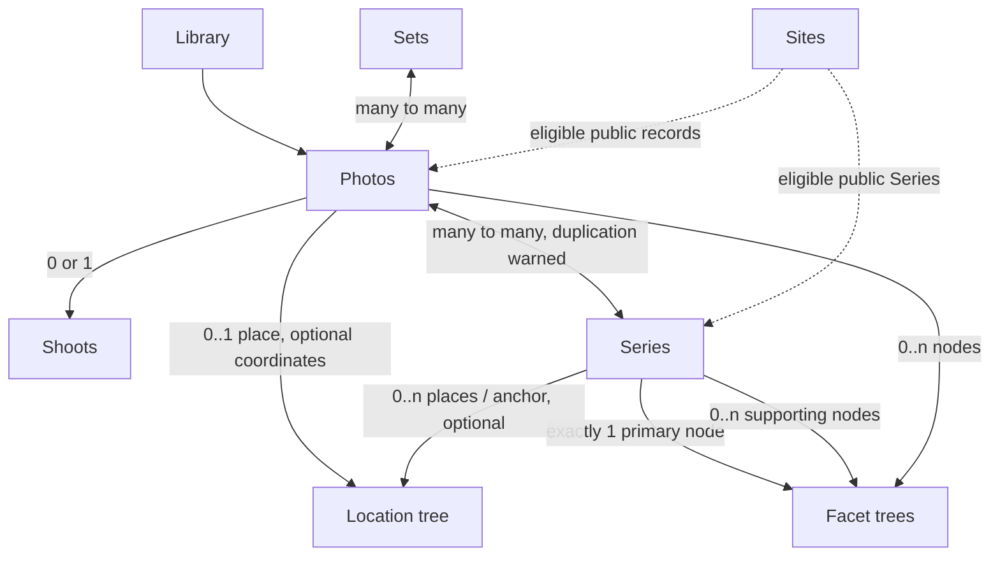

# FACETS: Workflow and Requirements Specification

**Version 1.0 (complete brief for a new build), 19 November 2026**
**Owner:** Cynmark Systems Limited. © Cynmark Systems Limited, all rights reserved. The application and its concept belong to Cynmark Systems Limited.
**Product name:** Facets
**Predecessor:** Legend 0.1 (kept installed and unchanged as a fallback)

This document is the single brief for building Facets from scratch in a new session. It assumes no memory of earlier conversations. It brings together:

- Legend v1.0 requirements (16 November 2026).
- The working Legend 0.1 application: its interface, look and engine.
- The Legend v2 workflow discussion (19 November 2026).
- Lessons from testing Legend 0.1.

Where a decision has been taken it is stated as a rule. The few remaining open choices are listed in section 28 with a default the builder should use unless told otherwise.

---

## Contents

1. Purpose and philosophy
2. Repositories, folders and reference material
3. Relationship to Legend: side by side, not a replacement
4. The three-application workflow
5. Terminology
6. Conceptual model and data relationships
7. Identity and naming
8. Import
9. Sets: the working scope
10. Shoots: capture provenance
11. Series: editorial collections
12. Facets and hierarchies
13. Location: a separate, optional system
14. Public, Private and Internal metadata; privacy
15. Classification Palettes
16. The two mapping tools
17. Photo-level editing (Describe)
18. Search, filter, sort and group
19. AI exchange: packages and patches
20. Operation History, undo and revert
21. Status and workflow progress
22. Export to websites
23. Interface: look and feel (keep Legend's)
24. Interface: layout, menus, workspaces and panels
25. Platform, installer, build and release
26. Data storage, safety and backward compatibility
27. Migration from Legend
28. Decisions taken and decisions still open
29. Build plan and acceptance tests
30. Performance targets
31. How to start the new session

Appendices:

- A. Design tokens
- B. Database outline
- C. File format examples

---

## 1. Purpose and philosophy

Facets is a Windows desktop application. It turns an edited photographic archive into a structured, searchable, geographically aware, privacy-controlled and editorially useful library, and publishes it to websites as JSON.

It is named after its core idea. **A photograph is understood through several independent facets, and no single tree is forced to carry every meaning.**

| Question | Answered by |
|---|---|
| What photos am I working on right now? | **Set** |
| Where did these photos come from (which outing)? | **Shoot** |
| Which coherent collection deserves documenting and publishing? | **Series** |
| Why does it matter: subject, activity, event, people or theme? | **Facets** |
| Where was it, if known and appropriate to keep? | **Location** |
| What may be shown publicly, what stays private, what is provisional? | **Public / Private / Internal** |

Facets does not edit pixels, develop RAW files, or change, rename, move or delete any image file. It does not build or host websites.

---

## 2. Repositories, folders and reference material

### 2.1 Repositories (all under https://github.com/SCMWJTT)

| Repository | Role for Facets |
|---|---|
| **SCMWJTT/facets** (new, to be created by the owner) | The new application. All Facets work happens here |
| **SCMWJTT/legend** | **Reference implementation.** The source of the interface, theme, components and proven engine code to reuse (section 2.3). Do not modify it from the Facets session except by explicit request |
| **SCMWJTT/filter** | Sibling app, first stage of the workflow (RAW culling). May be private. Shares the look and feel |
| **SCMWJTT/natura** | The first consuming website (natura.cynmark.app). May be private. Its build reads Facets exports |
| SCMWJTT/scandoc, wordgames, miniword, bigword, wordsolve | Unrelated projects. Listed only so they are not confused with the photo apps |

### 2.2 Local folders on the owner's machine (Windows)

| Folder | Content |
|---|---|
| `H:\DEV\_CODEII\Photo\facets` | Local working copy of SCMWJTT/facets (new) |
| `H:\DEV\_CODEII\Photo\legend` | Local working copy of Legend |
| `H:\DEV\_CODEII\Photo\filter` | Local working copy of Filter |
| `H:\INSTALLS\exiftool\exiftool.exe` | A standalone ExifTool. Facets bundles its own and does not depend on this |

The owner has one Windows machine with VS Code and Node installed. The owner does not want to run apps from npm or a terminal; every deliverable is an installer.

### 2.3 What to reuse from Legend

Copy these files from SCMWJTT/legend as the starting point, then reshape them for the new model. Paths are relative to the Legend repository.

| Legend file | Reuse for |
|---|---|
| `src/renderer/src/styles.css` | **The whole visual design.** Copy it verbatim first; it is the single most important thing to keep |
| `src/renderer/src/components/Icon.tsx` | Icon component and paths (extend with new icons) |
| `src/renderer/src/components/ui.tsx` | Menus, dialogs, prompt and confirm, toasts, splitter, star rating |
| `src/renderer/src/components/NodePicker.tsx` | Type-ahead hierarchy picker, including paths written with `>` |
| `src/renderer/src/components/MapPanel.tsx` | The **small Locate map**: keep its behaviour |
| `src/renderer/src/components/LibraryView.tsx` | Grid, table, single view, facet filter columns, toolbar (with the tile fix from commit `b735730`) |
| `src/renderer/src/components/Navigator.tsx`, `Inspector.tsx`, `Explorer.tsx`, `Registry.tsx`, `Dialogs.tsx`, `StatusBar.tsx` | Starting points for the equivalent Facets screens |
| `src/renderer/src/logic.ts`, `store.ts`, `api.ts`, `commands.ts` | In-memory filtering, sorting and grouping; state store; main-process bridge |
| `src/main/db/library.ts` | Library open/create, lock, backups, migrations, and the **Tx change recorder** that gives one-step undo and field history |
| `src/main/services/importer.ts`, `exif.ts`, `thumbs.ts` | Import with raw-key matching, ExifTool reading, thumbnail cache |
| `src/main/services/catalog.ts` | Hierarchy engine (closure table, merge, move), shoots, naming, sets |
| `src/main/index.ts`, `src/main/api.ts`, `src/preload/index.ts` | Window, protocol for thumbnails, request handling, screenshot test harness (`LEGEND_SHOT`, to be renamed `FACETS_SHOT`) |
| `electron-builder.yml`, `electron.vite.config.ts`, `.github/workflows/build.yml`, `tsconfig.json`, `vitest.config.ts` | Build, packaging and CI. Change names and IDs to Facets |
| `tests/` | Test style, fixtures and the 100,000-photo scale test |

Facets is a **new foundation**: a new data model and a new library format. It is not a patched Legend. Reusing the code above is expected and encouraged wherever it still fits.

---

## 3. Relationship to Legend: side by side, not a replacement

1. **Legend stays installed and untouched.** Facets has its own app ID (`app.cynmark.facets`), its own program folder, its own settings (`%APPDATA%\Facets`) and its own library format (`*.facetslib`). Installing or uninstalling either app never affects the other.
2. **Facets never writes to a Legend library.** It can **import** one (section 27), read-only, so all keywording, shoots, names and positions done in Legend come across.
3. Both apps read the same exported JPEGs, read-only, so running both on the same photos is safe.
4. Once Facets is proven, Legend can simply be uninstalled. Its library folder stays on disk as an archive.

---

## 4. The three-application workflow

| Stage | Application | Responsibility | Hands on |
|---|---|---|---|
| 1 | **Filter** | Fast culling of the RAW archive (about 100,000 Canon 5D Mark III CR2 files over about 12 years). Hide, pick, copy picks to destination folders. Never alters originals | RAW copies plus `filter-manifest-*.json` |
| 2 | **Lightroom Classic** (or a later replacement) | Develop, correct, choose final versions, export JPEGs **keeping the original file name** (for example `20130115-GZ3A7589.jpg`) with embedded EXIF, IPTC and XMP (title, caption, keywords, GPS) | Final JPEGs |
| 3 | **Facets** | Import read-only. Organise working Sets and Shoots. Build Series. Classify with Facets. Manage Location and privacy. Map. AI-assisted analysis. Publish versioned JSON | Website exports |

### 4.1 Lifecycle of the work in Facets

1. **Import** a folder of JPEGs. An import Set is created automatically.
2. **Work in a named Set** (the Active Set), drawn from one or many imports and Shoots.
3. **Reconstruct or confirm Shoots** from dates, file sequence and GPS, with proposals the user accepts.
4. **Locate:** correct positions, assign Location entries, or mark location unknown or not retained.
5. **Classify** photos with Facet keywords using Palettes and bulk actions. AI proposals arrive as reviewable patches.
6. **Editorialise:** create Series, choose each one's Primary Facet, write the narrative, choose a cover and featured photos.
7. **Verify:** resolve gaps and privacy, promote Internal tags to Public, mark items Ready.
8. **Publish** to selected sites as JSON snapshots. Private material never leaves.
9. **Maintain:** reopen any Set, revise, revert past operations, republish.

---

## 5. Terminology

Use these names consistently in the code, database, interface, documentation and exports. **Never interchange Set, Shoot and Series.**

| Term | Definition |
|---|---|
| **Library** | One Facets database folder (`Name.facetslib`) with thumbnails, backups and logs. One library serves all sites |
| **Photo** | One imported JPEG. A second edit of the same RAW is its own Photo (a variant) |
| **Raw key** | The file name without its extension, compared ignoring letter case, for example `20130115-GZ3A7589`. The bridge to the RAW and to Filter. Never published |
| **Photo record ID** | Internal, permanent, hidden numeric ID of every Photo from the moment of import |
| **Photo ID** | The permanent public identity, `SHOOTCODE-00001` (Legend called this "Legend ID"). Issued only once a Photo is in a Shoot. Never reused |
| **Published name** | Public file name from a template, frozen at first publication; renames keep redirects |
| **Set** | A named working selection of Photos. Many-to-many. Imports create one. **Not** provenance, editorial meaning or publication |
| **Active Set** | The Set that scopes the grid, filters, Map, Palettes and AI export by default |
| **Shoot** | A real-world capture outing or occasion. Four-character permanent code. A Photo has at most one Shoot |
| **Series** | An independent editorial collection with one primary purpose. Many-to-many with Photos; may span Shoots. Has its own permanent **Series ID** |
| **Facet** | One of five classification dimensions: **Subject, Activity, Event, People, Theme**. Each owns a controlled keyword tree |
| **Primary Facet** | Exactly one Facet (and one keyword in it) giving a Series its single editorial home |
| **Supporting keywords** | Further keywords on a Series, in any Facet. They aid discovery and never duplicate the Series |
| **Node** | One entry in a tree: permanent ID, label, aliases, parent, optional description, references, short code, domain |
| **Location** | Separate geographic system: place tree, coordinates, location state, precision. **Not a Facet; optional** |
| **Domain** | Public, Private or Internal: what may be published, what must stay local, what is provisional |
| **Palette** | A saved group of keyword buttons for fast add and remove on the selection |
| **Slice** | A derived view, for example "Shoot ASHW and Location Maracas Beach". Can be saved as a view or turned into a Set; it is not a new object |
| **Site** | A publishing target (Natura first) with its own rules and export history |
| **Operation** | One recorded user, AI or system action, persistent, reversible where safe |
| **AI Package / AI Patch** | Export for analysis / imported proposals reviewed before applying |
| **Locate** | The small per-photo map editor in the inspector (map tool 1) |
| **Map** | The full-screen geographic workspace (map tool 2) |

### 5.1 One worked example

- **Set:** `Client X — 19 Nov`. 200 photos from several Shoots, today's work.
- **Shoot:** `Ash Wednesday 2026`, code `ASHW`. Photos are `ASHW-00001` and onwards.
- **Slice:** `ASHW ∩ Maracas Beach`. About 100 photos. A view, not a new Shoot.
- **Series:** `Richard's Bake and Shark — Ash Wednesday 2026`, ID `SER-000014`.
  - Primary Facet: Subject › Food › Prepared food › Bake and shark.
  - Supporting keywords: Event › Carnival › Ash Wednesday 2026; Activity › Food preparation.
- **Location:** Trinidad and Tobago › Trinidad › Maracas › Maracas Beach.

---

## 6. Conceptual model and data relationships



### 6.1 Cardinality rules

| Relationship | Rule |
|---|---|
| Photo → Shoot | 0 or 1. Unassigned is allowed during import and reconstruction. Required before a Photo ID is issued |
| Photo ↔ Set | Many to many |
| Photo ↔ Series | Many to many. A soft warning on heavy overlap; never a hard block |
| Series ↔ Shoot | **No stored link.** Associated Shoots are derived from member Photos |
| Series → Primary Facet | Exactly one Facet and one node, at the deepest accurate level |
| Series → supporting nodes | Zero or more, in any Facet |
| Photo → Facet nodes | Zero or more, several per Facet allowed |
| Photo → Location node | Zero or one (the place where it was taken) |
| Series → Location | Zero or more places, plus an optional anchor point |
| Set → Series | A Set *shows* the Series its Photos belong to; it does not own them |

### 6.2 Avoiding double-dipping

- A Series is never a disguised Shoot or subgroup. A Shoot is never an editorial category.
- One Series has **one canonical home** (its Primary Facet). It is not cloned under other Facets.
- Shoot, Series and Photo each own their own text. Copying text between them is an explicit action, never hidden inheritance.
- Series keywords are not silently stamped onto member Photos. "Apply Series keywords to member photos" is an explicit, previewed, undoable command.
- Map clusters are never Series until a user deliberately promotes them.

---

## 7. Identity and naming

### 7.1 Identifiers

| Identifier | Example | Visible | Changes |
|---|---|---|---|
| Photo record ID | `48213` | Facets only | Never |
| Raw key (+ variant number) | `20130115-GZ3A7589` (v2) | Facets only | Never |
| Photo ID | `ASHW-00001` | Public | Never once issued |
| Published name | `2026-02-18-ash-wednesday-ASHW-00001` | Public | Only by explicit rename, keeping the old name |
| Shoot code | `ASHW` | Public | Never reused |
| Series ID | `SER-000014` | Public | Never reused |
| Node ID | `subj-0142` | Public in exports | Never reused |

### 7.2 Rules carried over from Legend

- Shoot codes are exactly four capital letters or digits, unique for ever, including archived shoots and codes created then undone. When a shoot is named, Facets proposes a code from its name and shows at once whether it is free.
- Photo IDs are `CODE-` plus at least five digits. They are issued by "Assign Photo IDs" in capture order, continuing from the shoot's counter. Withdrawn numbers are retired, never reissued. A Photo cannot change Shoot after its first export.
- The published-name template is built from segments (date formats, shoot slug, code, number, Series slug, the label of a chosen Facet at a chosen level, fixed text). The default is `{date:YYYY-MM-DD}-{shoot}-{code}-{number}`. Names are frozen at first export.
- The ID counters and the registry are written **outside** the undo log, so an undo can never cause an ID to be issued twice. After any undo or redo, the registry is reconciled.

### 7.3 Series IDs

- Format `SER-` plus six digits, global, monotonic, never reused. They are independent of shoot codes and Facets, because both can change.
- The title is human-readable and must be unique among active Series. Facets suggests adding a year or place on a clash. A title can change; the ID cannot.

### 7.4 Name registry

A workspace listing:

- every shoot code (active or archived) with name and count;
- every Photo ID ever issued, with raw key, published name, previous names, state and retired numbers;
- every Series ID with its title history;
- Legend subgroup aliases (for example `MALM-s02` → `SER-000003`).

It is searchable and sortable, exports to CSV, and answers "which raw file is ASHW-00012?" and "has code MALM been used?".

### 7.5 Optional short codes on nodes

Any node (Facet or Location) may carry an optional **short code**, for example `QPKS` for Queens Park Savannah or `WDBK` for Woodbrook. It is used for display on buttons, quick typing in the picker, and the owner's own reference.

- Short codes are unique within a tree.
- They are **not** part of Photo IDs. Photo IDs come from Shoots because places get corrected and refined, and a permanent ID must not depend on something that will change.

---

## 8. Import

Everything from Legend's import is kept:

1. Choose a folder (optionally with subfolders) of `.jpg` and `.jpeg` files, in any letter case. Other files are skipped and listed. Folders can also be dragged in.
2. The raw key is the file stem. An optional pattern in Settings extracts it from longer names (for example ignoring `-Edit`). The embedded tags `PreservedFileName` and `RawFileName` are checked; a mismatch is flagged and the file name wins.
3. Matching:

   | Situation | Result |
   |---|---|
   | New raw key | New Photo (Draft), fields seeded once from embedded metadata |
   | Known, same content (size and time, then hash) | "Already catalogued". Path refreshed, nothing else changes |
   | Known, different content | "Re-exported". Thumbnail and camera data refreshed; **all catalogue data kept** |
   | Two files with one raw key in one import | Ask: variants or replacement. Never decided silently |
   | Unreadable | Skipped and listed |

4. **Seeding on first import:**
   - title, caption (headline), note or caption (description), alt text, rating, creator, copyright (with Settings defaults);
   - GPS and elevation, capture time, camera data;
   - Lightroom hierarchical keywords through a **keyword root mapping** into Facets (Settings);
   - flat keywords into an `Unsorted` node;
   - IPTC Country, State, City and Location into the Location tree.

   Seeded classifications go into the **Internal** domain until reviewed (section 14).
5. **Location retention choice on import:** keep coordinates, or **do not retain location** for this import (for private places). Source files are never changed.
6. A summary report shows new, known, re-exported, variants, skipped and flagged files, each with its file list. It is saved in import history and the log.
7. Two thumbnail sizes (grid 480 px, preview up to 2000 px) are generated up front in the background, on-screen first, with pause and resume. The grid is usable at once.
8. Missing files (drive unplugged) keep working from cached thumbnails and show an "offline" badge. Re-importing relinks by raw key.
9. "Re-read embedded metadata" into chosen fields is a separate, explicit command.
10. A Lightroom keyword list (the tab-indented file from Export Keywords, with `{synonyms}` and `[brackets]`) can be imported into any tree.
11. A Filter manifest (`filter-manifest/1`, section 22.6) can be read to show which Photos came from which Filter pick batch.

---

## 9. Sets: the working scope

1. A Set is a saved list of Photo record IDs. Sets are many-to-many and have no effect on publishing.
2. Every import creates an import Set. The user can create named Sets from a selection, a filter, a map selection or a slice.
3. **Active Set:** clicking a Set in the navigator makes it active. The grid, table, filters, facet columns, Palettes, Map (by default) and AI export all work within it.
   - A scope switch shows clearly: **Active Set / All Library / Current selection**.
   - The status bar always states the scope, for example "Set: Client X — 19 Nov · 200 photos".
4. Under an active Set, the navigator shows the **Shoots, Series, Locations and Facet keywords represented in it**, with counts that act as filters. Ownership is never implied.
5. Commands:
   - add selection to Set;
   - remove from Set;
   - create Set from selection or filter;
   - replace Set contents;
   - duplicate, rename or archive Set;
   - save the current filter as a **saved view**, which is distinct from a Set.
6. Membership changes are recorded in Operation History.
7. A Set remembers its own progress (section 21) and is reopened exactly as it was left.

---

## 10. Shoots: capture provenance

1. Shoot fields:
   - code, name, description;
   - start and end (derived from its Photos), time zone;
   - **clock correction in minutes**, applied to displayed capture times;
   - cover, privacy default (**Private** for new Shoots), archived flag;
   - optional list of places visited (derived, or entered).
2. A Shoot may cover many places, activities and Series. It never owns Series.
3. Create a Shoot from the selection (Ctrl+N), drag Photos onto it, or accept proposals.
4. **Shoot reconstruction** (Tools → Propose Shoots) over the Active Set:
   - Sort by capture time (with clock corrections), then by raw-key sequence.
   - Propose boundaries from adjustable time gaps and large jumps in position.
   - Show the proposals with counts, date ranges, a map extent and low-confidence members.
   - The user accepts, splits, merges or rejects each one before anything is created.
   - Thresholds are suggestions, never definitions.
5. Provenance is recorded on each assignment: user, embedded metadata, local heuristic, AI patch, or verified.
6. A Shoot with issued Photo IDs can be archived but never deleted.

---

## 11. Series: editorial collections

### 11.1 Definition

A Series is a deliberately curated, documented collection of Photos united by one primary editorial purpose. It may use Photos from several Shoots. It need not have a location. It sits under exactly one Primary Facet.

### 11.2 Fields

| Field | Rule |
|---|---|
| Series ID | `SER-000001` and onwards, permanent |
| Title | Required, unique among active Series, may change |
| Slug | Derived from the title, frozen at first publication; old slugs kept for redirects |
| Primary Facet + primary node | Exactly one, deepest accurate level |
| Supporting nodes | Zero or more, any Facet |
| Summary | Short text for cards, map pop-ups and listings (soft limit 240 characters) |
| Narrative | Long text: paragraphs, `*italic*`, `**bold**`, headings, links |
| Theme rationale | Required when the Primary Facet is Theme (one or two sentences) |
| Members | Ordered list of Photos. Order is by capture time or a manual editorial order |
| Cover and featured | One cover, plus an ordered shortlist of up to 12 |
| Places and anchor | Zero or more Location nodes; optional anchor point (dragged on the Map); may be absent, approximate or hidden |
| Date span | Derived from members; optional display label that never overwrites capture data |
| Privacy | Public, Private or Internal (section 14); default Private until chosen |
| Sites | Per-site eligibility |
| Write-up reference | Link or ID of a long article on the website |
| Sources | Optional references for fact checking |
| Provenance and verification | User or AI authored, verified flag, history |

### 11.3 Rules

- **No stored shoot link.** The Shoots a Series covers are shown, derived from its members.
- A Photo may be in several Series. On creating or editing a Series, Facets warns when more than 80% of its members are shared with another Series that has the same primary node or a similar title. The user may proceed.
- A Series can exist in draft with little text. It must pass Series readiness checks before publishing: title, primary node, summary, cover, privacy decided.
- Creating a Series:
  - "New Series from selection" (Ctrl+Shift+N);
  - from a map selection;
  - from an AI proposal;
  - from a migrated Legend subgroup.
- Deleting a Series is a soft retire; its ID is never reused.

### 11.4 Series editor

The editor is separate from the photo **Describe** tab. It is reachable as:

- the **Series** tab in the inspector when a Series is the current target (selected in the navigator or Series workspace);
- the **Series workspace** (section 24.3), for browsing, comparing and authoring many Series.

The editor shows every field in 11.2 plus a member strip (drag to reorder, set cover, add to featured), the derived Shoots and dates, a small map of its places, privacy and site eligibility, and its history. **The current editing target (Series or Photos) is always unmistakable**: a coloured header strip reads "Editing Series SER-000014" or "Editing 42 photos".

### 11.5 Series navigator

```
SERIES
  ◆ Subject
      Food › Prepared food
        Richard's Bake and Shark — Ash Wednesday 2026 · SER-000014   [38]
  ▶ Activity
      Agriculture › Harvesting
        Cocoa harvesting in Trinidad · SER-000021                     [64]
  ★ Event
  ● People
  ✦ Theme
```

A Series is listed once, under its Primary Facet. Searching by a supporting keyword still finds it.

---

## 12. Facets and hierarchies

### 12.1 The five Facets

| Facet | Defining question | Belongs here | Example paths |
|---|---|---|---|
| **Subject** | What is the main thing shown? | Tangible things: plants, animals, buildings, landforms, food, objects | `Living things › Plants › Cocoa`; `Built environment › Structures › Lighthouses` |
| **Activity** | What is being done? | Actions, processes, work, recreation | `Agriculture › Harvesting › Cocoa harvesting`; `Recreation › Hiking` |
| **Event** | Which specific occasion? | Named or dated occurrences: festivals, ceremonies, weddings, competitions | `Cultural events › Carnival › Ash Wednesday 2026` |
| **People** | Who is the focus? | Persons, families, groups, occupations. Names are **Private** by default | `Occupations › Farmers` (Public); `Family › [name]` (Private) |
| **Theme** | Which larger idea? | Interpretive concepts across subjects and shoots | `Environment › Biodiversity`; `Society › Rural livelihoods` |

**Choosing a Primary Facet for a Series:** complete the sentence "This Series exists mainly to document ___". A thing → Subject. An action → Activity. A named occasion → Event. A person or group → People. An idea → Theme (with a rationale). Then choose the deepest *accurate* node, never inventing a species, name or place to reach a deeper level.

### 12.2 Hierarchy engine (keep Legend's, extend)

- One engine serves the five Facet trees, the Location tree and any legacy trees.
- Each tree has a permanent key, a name, a domain default, level names, "one or many entries per Photo", and "nodes carry map positions" (Location only).
- Each node has:
  - a permanent ID and public ID (`subj-0142`);
  - a label, aliases, an optional short code and a description (used as a gallery introduction);
  - a cover, sort order, external references (for example eBird code or species ID);
  - a domain (Public, Private, Internal) and a retired flag;
  - **cross-references** to nodes in other trees (for example Subject `Cocoa` ↔ Activity `Cocoa harvesting`).
- Choosing a node implies its ancestors. Only the chosen node is stored. Exports write the full path.
- Maintenance (from Legend's explorer):
  - rename, drag to move (before, after or into), merge (moves photos and children and keeps the old label as an alias);
  - retire or restore; delete only if never used;
  - unused-node and similar-label reports;
  - outline import and export in both **tab-indented text (Lightroom-compatible)** and **JSON** (section 22.5).
- Depth is unlimited. Theme and People may stay shallow.
- **Adding a sixth Facet** is a guarded action under Options → Facets (name, key, definition, icon, guidance) with a warning. It is never offered in everyday pickers.

### 12.3 Starter trees

A new library contains the five Facets with these top levels, each with no children, plus the Location tree with its levels. The user builds the detail; AI-assisted drafting of fuller trees is expected later (section 19).

| Facet | Top-level nodes |
|---|---|
| Subject | Living things › Plants, Animals, Fungi; Landscapes; Water; Sky and weather; Built environment; Objects; Food |
| Activity | Agriculture; Fishing; Work and industry; Food preparation; Recreation; Sport; Travel and sightseeing; Daily life |
| Event | Cultural events; Celebrations; Exhibitions; Competitions; Religious observances |
| People | Occupations; Groups; Portraits; Family (Private) |
| Theme | Environment; Heritage; Society; Economy |
| Location (levels: Country, Island or Region, Area, Locality, Site) | Trinidad and Tobago › Trinidad, Tobago |

### 12.4 Assigning

- The Classify tab has one block per Facet plus Location.
  - Each block shows chips with their path.
  - With many photos selected, chips show "n of m" with add-to-all and remove buttons.
- The picker searches labels, aliases and short codes, shows full paths, and creates new nodes (including paths typed with `>`).
- Photos can be dragged onto any node in the navigator or explorer. Palette buttons work too (section 15).

---

## 13. Location: a separate, optional system

### 13.1 What is stored per Photo

| Value | Meaning |
|---|---|
| Camera position | Latitude, longitude and elevation from the file. Never altered. Not stored at all if "do not retain location" was chosen |
| Current position | Starts as the camera position; editable; source: camera, by hand, from place, or none |
| Elevation and "publish elevation" | Camera GPS elevation is unreliable, so publishing it is off by default |
| Location node | The named place, zero or one |
| **Location state** | `known`, `approximate`, `unknown`, `missing GPS`, `hidden`, `not retained`, `not applicable` |
| Publishing precision | Exact, rounded (to the site's decimal places), approximate (snapped to the place node), hidden |
| Private place flag | Forces hidden, and blocks the place name in public output |

### 13.2 Rules

- Location is **never required** for Ready. An explicit state (`unknown`, `not retained`, `not applicable`) satisfies the check.
- GPS only **suggests** a place: the nearest node with a position within a set distance, with confidence. The user accepts or ignores it. Nothing is assigned automatically.
- Avoid false precision: "Manzanilla" is right when "Brigand Hill" is not verified.
- "Purge location" removes stored camera and current coordinates and the place from chosen Photos (logged; recoverable only from backups).
- A place *name* can reveal a private home as much as coordinates can, so privacy rules apply to names too (section 14).

---

## 14. Public, Private and Internal metadata; privacy

### 14.1 Domains

| Domain | Used for | Export |
|---|---|---|
| **Public** | Verified titles, keywords, places and Series text meant for websites | Only if the owning Photo or Series is eligible for that site |
| **Private** | Named people, family relations, home places, exact private positions, rights restrictions | **Never**, anywhere: not in sidecars, image copies, maps, search indexes or file names |
| **Internal** | Provisional, AI or heuristic tags, candidate species, rough places, research labels | Never by default. Becomes Public only by explicit **Promote** |

- Domains apply to nodes (a default) and to individual assignments.
- A Private node under a Public ancestor never makes the ancestor reveal it.
- **Promote**, **Demote**, **Redact** and **Retire** are explicit, logged operations.
- "Hidden from navigation" is a display setting, separate from domain.

### 14.2 Object privacy

| Object | Control |
|---|---|
| Shoot | Private by default. Its restriction applies to its Photos unless relaxed |
| Series | Public, Private or Internal; Private by default. A Private Series is never exported in any form (record, title, text, membership, places) |
| Photo | Own privacy, per-site eligibility, people flag, private-place flag, location state |
| Set | Working scope only; never grants publication |
| Site | Allowlist of trees and fields, coordinate precision, export history |

**Rule: deny by default, and the most restrictive constraint wins.**

**Policy for a Photo in a Private Series (decided):** it may still be published on its own merits only if it is independently eligible (its Shoot and Photo allow it, and the site selects it). Even then, nothing about the Private Series appears with it: no title, text, slug, membership, cover status or places. Before the first publication of any Photo that belongs to a Private Series, Facets asks for confirmation once per Photo and logs the answer.

### 14.3 Privacy audit

Tools → Privacy audit runs the export checks without writing files. It lists anything Private or Internal that would leak through any path: titles, captions, alt text, file names, slugs, node paths, places, coordinates, Series references or covers. The same audit runs automatically before every export and blocks it on failure.

---

## 15. Classification Palettes

1. A docked panel (right side, beside the inspector, collapsible) holding **Palettes**: named groups of buttons, for example `Coastal`, `Agriculture`, `Trinidad places`, `Family (Private)`.
2. Each button points to a node ID (Facet or Location), never free text. It shows the node's label (or short code), its Facet icon and its domain colour.
3. Each button shows the state on the current selection: **all** (filled), **some** (half), **none** (outline).
   - Click adds to all selected Photos. Clicking when all already have it removes it.
   - Alt-click always removes. Shift-click replaces the other nodes of that tree on the selection.
   - Buttons can be dragged onto photos, and photos onto buttons.
4. Every press is one transaction and one undo step, with a status-bar confirmation such as "Cocoa added to 42 photos (Set: Client X)".
5. Palette management:
   - create, rename, duplicate, reorder and pin;
   - add buttons from any picker or tree (right-click → Add to palette);
   - remove a button (never touches the node or its assignments);
   - search across all buttons;
   - "Recent" and "Frequent" automatic palettes.
6. Keyboard: number keys 1–9 with Alt press the first nine buttons of the open palette.
7. Palettes are stored in the library, so they travel with it.

---

## 16. The two mapping tools

Facets has **two separate map tools**. Both use Leaflet with the street and satellite tile sources set in Settings, and both show a clear offline message when tiles cannot load.

### 16.1 Map tool 1: Locate (small, per-photo, in the inspector). Keep exactly as in Legend

The Locate tab of the inspector keeps Legend's behaviour unchanged:

- A small embedded map, about 260 px high, with a Map/Satellite switch.
- Selected Photos as amber pins. A single photo's pin is draggable to correct it.
- The camera's original position as a faint ring, with a dashed line to the current position.
- "Place by clicking" / "Place selection here" (crosshair mode).
- "Camera position" (restore), "Location's position" (use the place node's point), "Clear".
- Latitude and longitude typed or pasted (`10.652, -61.441`); Copy and Paste position.
- Elevation field, "Publish elevation", publishing precision segments, "No location" and **location state**.
- "Nearby: <place> (420 m) — Use" suggestion.
- The anchor of the photo's Series as a blue diamond marker, draggable (Series anchor).
- More than 60 pins cluster.

This is a quick editor for the current selection. It is not replaced by the Map workspace.

### 16.2 Map tool 2: Map workspace (full screen, top-level tab)

A new top-level workspace for geographic discovery and bulk work.

1. **Scope:** Active Set (default), current filter, selection, or All Library. The scope is always shown.
2. **Layers** (toggles): Photos (points), automatic clusters, Shoots (extents or tracks in capture order), Series (anchors and places), Location places (nodes with positions), Atlas preview (what the public site would show, after privacy and precision).
3. **Distinct markers, so nothing is ambiguous:**

   | Marker | Look |
   |---|---|
   | Photo | Small amber dot |
   | Automatic cluster | Grey disc with count, no thumbnail |
   | Shoot | Outlined route or extent in a muted colour, labelled with its code |
   | Series | Rounded-square cover thumbnail with the Primary Facet icon badge and member count |
   | Place (Location node) | Small pin with label |
   | Private item (local only) | Lock badge |

4. **Synchronised with the grid:** selecting markers, a cluster, a lasso area or a Series selects or filters those Photos in the Library grid, and the grid's selection highlights on the map. A split view puts the map and a thumbnail strip side by side.
5. **Selection tools:** click, Shift-add, rectangle, lasso, polygon.
6. **Actions on a map selection:**
   - Create Set, create Series, propose Shoot;
   - assign Location node, set positions (place here, move, clear, restore camera);
   - set precision, set location state.
7. **Clustering controls:** adjustable spatial radius and time window. Clusters are proposals; "Promote to Series" or "Promote to Shoot" is an explicit action with a preview.
8. **Facet filter:** for example show only Series whose Primary Facet is Activity, or Photos tagged with a chosen node (including below it).
9. **Hover cards:**
   - Photo: preview, title, Photo ID or raw key, capture time.
   - Series: cover, title, summary, counts, privacy.
   - Cluster: up to three thumbnails and a count.
10. **Missing-location lane:** a side list with counts of Photos with no coordinates, malformed GPS, hidden or not retained. Select them, then place them, assign a place, or set their state.
11. **Timeline strip** under the map: filter by date range; shows capture density.
12. **Search box:** finds Location nodes, Series and Shoots and flies the map to them.
13. **Scale:** viewport rendering with clustering and a spatial index (R-tree or grid). It stays smooth with 100,000 photos and never creates all marker elements at once.
14. **Privacy:** Private items appear only in this local editor. Atlas preview applies the site's rules exactly as an export would.

---

## 17. Photo-level editing (Describe)

Keep Legend's inspector behaviour:

- **Fields:** title; caption (soft limit 240 with a counter); note (long; blank line = paragraph; `*italics*`); alt text (soft limit 150); rating 0–5; creator, copyright, licence, credit (defaults from Settings); identifiable-people flag; private-place flag; per-site selection; status.
- **Many photos selected:**
  - each field shows its shared value, or "Multiple values";
  - only changed fields are written;
  - text modes are Replace, Add to start, Add to end, and Find and replace;
  - a bulk edit is one transaction and one undo step;
  - a status-bar confirmation follows.
- **Copy and paste fields:** Ctrl+Shift+C / Ctrl+Shift+V, with a checklist of fields, each Facet (add or replace), Location, Shoot and Series membership. "Paste again" (Ctrl+Alt+V) repeats the last choice.
- **Read-only panel:** raw key and variant, Photo ID, published name, file path (Show in Explorer), pixel size, capture time (with clock correction), camera, lens, exposure, import date, modified, last exported.

---

## 18. Search, filter, sort and group

- **Full-text search (SQLite FTS5)** across:
  - Photo title, caption, note and alt text;
  - Series title, summary and narrative; Shoot name and description;
  - node labels, aliases and short codes; raw keys and IDs.

  Private content is searchable locally only.
- **Facet filter columns** above the grid (from Legend, keep). Up to six columns, each any dimension: any Facet tree, Location, Shoot, Series, Primary Facet, year, month, time of day, rating, status, domain, privacy, camera, lens, location state. Columns narrow each other and show counts.
- **Missing filters:** title, caption, note, alt text, Shoot, Series membership, Photo ID, position, location state, any Facet.
- **Flags:** offline, people, private place, variants, changed since export, Internal tags pending review, AI proposals pending.
- **Sort:** capture time, raw key, Photo ID, title, rating, status, import date, last modified, Shoot, Series, any tree path.
- **Group** with collapsible headings: Shoot, Series, capture date, month, year, or any tree at a chosen level.
- **Saved views:** a source plus filters plus sort, listed in the navigator.
- All counts respect the current scope and say so ("in Set / in library").

---

## 19. AI exchange: packages and patches

Facets works fully without AI. AI is used through files exchanged with any tool: a chat assistant, a local model, or a future optional API. **No network calls are made by Facets for AI unless a future opt-in setting is enabled.**

### 19.1 Export AI Package (File → Export AI Package…)

The package covers the Active Set, a selection or a filter. It is written to a chosen folder:

```
FACETS-AI-<library>-<batch>/
  manifest.json        format "facets-ai-package/1", batch ID, library ID, created, scope, privacy profile, file hashes
  instructions.md      plain-language task for the AI, the rules (use only listed node IDs, propose new nodes separately, no guessing names or species), and the patch format
  photos.json          per photo: ref number, record ID, raw key, file name, capture time, camera, permitted GPS, current nodes, Shoot, Series
  trees.json           permitted Facet and Location trees (IDs, labels, aliases, short codes)
  shoots.json, series.json   permitted existing records
  sheets/sheet-001.jpg       4×4 contact sheets, about 2048 px, each image labelled with its ref number and raw key
  previews/<rawkey>.jpg      optional individual previews (768–1024 px)
```

- The privacy profile defaults to excluding Private nodes, names, exact positions and Private Series. Including any of them requires an explicit, logged choice.
- Batches are chunked (default 100 photos with previews; metadata-only for any size).

### 19.2 Import AI Patch (File → Import AI Patch…)

```
facets-ai-patch/1 (one JSON file or a folder)
  manifest            must reference the package batch ID and library ID
  photoUpdates[]      { ref | rawKey, add: {facetKey:[nodeId]}, remove, location: {nodeId, state}, alt, caption, confidence, evidence }
  newNodes[]          { tempId, tree, parentId | parentTempId, label, aliases, rationale }
  shootProposals[]    { name, suggestedCode, members[], confidence }
  seriesProposals[]   { title, primaryNode, supporting[], summary, narrative, cover, featured[], members[] }
  reviewNotes[]       { ref, message }
```

- **Preview first:** counts, matched photos, unknown refs, new nodes (with duplicate detection against labels and aliases), conflicts, low confidence, privacy implications.
- Review per photo, per proposal or in bulk; accept, reject or edit.
- Accepted classifications go into the **Internal** domain by default (or Public if explicitly chosen). Each accepted patch is **one operation**, revertible later.
- AI may never change privacy, publish, overwrite verified text, change IDs or create a Facet.
- The patch is refused if its hashes do not match the library and photos (so it can't silently apply to changed photos).

### 19.3 Tree drafting

"Export trees for drafting" writes `trees.json` plus instructions. A returned file in the taxonomy format (section 22.5) is merged through the same preview: new nodes, aliases and moves, all reviewable.

---

## 20. Operation History, undo and revert

Keep Legend's engine: every write goes through a recorder that logs `set`, `insert` and `delete` changes per action, which gives one-step undo for bulk actions and per-field history. Extend it:

1. **Persistent operations.** Each operation stores:
   - ID and time; label; source (manual, palette, bulk, AI patch, migration, import, publish);
   - scope (Active Set, filter, map selection);
   - the **concrete target IDs**;
   - before and after values, parameters, result counts and warnings.
2. **Undo and Redo** (Ctrl+Z / Ctrl+Y): at least 200 steps per session.
3. **Historical revert:** History workspace → pick any past operation (days later, after restarts). It shows a preview of what would be reverted and any **conflicts** (fields changed since). Revert applies an inverse operation, itself logged.
4. History tabs exist for a Photo, a Series, a Shoot, a node and a Set, plus a global History workspace with filters (date, source, target).
5. Exports are logged as external effects. They cannot be "undone"; the remedy is "re-export" or "withdraw".
6. Counters and registries are never rolled back (section 7.2).

---

## 21. Status and workflow progress

- **Status per Photo:** Draft → Ready → Published (per site) → Withdrawn.
- **Status per Series:** Draft → Ready → Published (per site) → Withdrawn.
- **Ready checks** (each switchable in Settings):
  - Photo: Shoot, Photo ID, title, alt text, creator and copyright, location **state** decided, no pending AI proposals, no unpromoted Internal tags on public-facing fields.
  - Series: title, primary node, summary, cover, privacy decided.
- **Workflow progress**, tracked per Photo and summarised per Set:
  1. imported;
  2. provenance reviewed;
  3. location reviewed;
  4. classification reviewed;
  5. Series reviewed;
  6. privacy and rights verified;
  7. ready;
  8. published or withheld.

  A Set shows a progress bar with counts per step, and filters jump to what is left.
- "Changed since export" marks edited published items until the next export.

---

## 22. Export to websites

### 22.1 Site snapshot (per site; replaces Legend's export)

The snapshot is complete, never partial, written atomically (temporary folder then swap), keeping the last 10. Format `facets-export/1`:

| File | Content | Deployable |
|---|---|---|
| `manifest.json` | format, app version, site, time, counts, schema hash | Yes |
| `photos.json` | eligible Photos keyed by Photo ID: published name, previous names, text, rating, rights, capture time, size, camera, position after precision, **public** nodes per Facet with paths, Location path, Series IDs (public only) | Yes |
| `series.json` | eligible public Series: ID, slug, previous slugs, title, summary, narrative, Primary Facet and node path, supporting paths, ordered members, cover, featured, places and anchor after precision, date span, write-up | Yes |
| `facets.json` | Facet definitions and only the **public nodes actually used**, with safe ancestors | Yes |
| `locations.json` | Public Location nodes used, with positions after precision | Yes |
| `shoots.json` | Public shoot codes, names, slugs, dates (as the site needs) | Yes |
| `withdrawn.json` | Photo IDs and Series IDs withdrawn since the last export, plus redirects | Yes |
| `private.json` | Local only: Photo ID → raw key, source file, exact position | **Never** |
| `export-report.txt` | Counts, first publications, changes, withdrawals, items left out and why, privacy audit result | No |

Rules:

- Only Ready or Published items selected for the site are included.
- The privacy audit must pass.
- Precision is applied before writing.
- Private and Internal data never appear in deployable files.
- A Private Series is absent as a whole object.

### 22.2 Working Set sidecar

File → Export Set sidecar writes the same structure for one Set, marked `"partial": true` in the manifest, for other apps or tests. It never replaces a site snapshot.

### 22.3 Atlas contract

The website Atlas shows **Series markers**:

- each with cover, title, summary, Primary Facet icon and link;
- placed at the Series anchor, or at its places after precision;
- Series without a public location get no marker;
- a cross-place Series may show several markers or none.

Photos not in any Series remain browsable in galleries by Facet and Location.

### 22.4 Compatibility with the current Natura build

During transition, an optional "Legend-compatible export" writes Legend's `legend-export/1` files (`photos.json`, `hierarchies.json`, `shoots.json` with subgroups derived from Series) so Natura keeps working until its build is updated.

### 22.5 Taxonomy file format (import and export of a tree)

```json
{
  "format": "facets-taxonomy/1",
  "tree": { "key": "subject", "name": "Subject", "kind": "facet", "entriesPerPhoto": "many",
            "levels": ["Group", "Subgroup", "Family", "Species"], "domain": "public" },
  "nodes": [
    { "id": "subj-0003", "label": "Living things", "children": [
      { "id": "subj-0040", "label": "Animals", "children": [
        { "id": "subj-0142", "label": "Copper-rumped Hummingbird", "shortCode": "CRHU",
          "aliases": ["Amazilia tobaci"], "refs": { "ebird": "corhum1" },
          "crossRefs": ["act-0077"], "description": "" }
      ]}
    ]}
  ]
}
```

On import, nodes without an `id` are new. Matching is by ID, then by label and alias under the same parent. A preview is shown before any change.

### 22.6 Filter manifest (read)

Facets reads `filter-manifest/1` (Filter requirements, section 13): batch, destination, files (`rawKey`, `file`, `source`, `destination`, `captured`, `size`, `fingerprint`, `sidecar`). It shows "picked in Filter, batch N, date" in the Photo's read-only panel and as a filter.

---

## 23. Interface: look and feel (keep Legend's)

**The owner likes Legend's interface: its colours, layout, title bar, borderless panels and calm dark look. Facets must look the same.** Copy `styles.css` from Legend first and extend it; never restyle from scratch.

### 23.1 Principles

1. **Dark, calm, borderless.** Areas are separated by tone and spacing, never by lines.
2. **Controls appear when wanted:** secondary actions fade in on hover.
3. **One warm accent (amber)** for selection, primary buttons, focus and progress. Everything else is neutral grey.
4. **Quiet labels:** 11 px uppercase, letter-spaced, dim.
5. **Soft geometry:** radius 8 general, 6 small controls, 9 tiles, 14 dialogs.
6. **Gentle motion:** 120–250 ms; menus and dialogs rise 6 px and fade.
7. **Photos first:** minimal chrome.

### 23.2 Design tokens

These are exactly Legend's (Appendix A). Additions for Facets:

| Token | Value | Use |
|---|---|---|
| `--f-subject` | `#7fb77e` | Subject icon tint |
| `--f-activity` | `#e0a85e` | Activity icon tint |
| `--f-event` | `#d98aa8` | Event icon tint |
| `--f-people` | `#7aa7e0` | People icon tint |
| `--f-theme` | `#b49be0` | Theme icon tint |
| `--d-private` | `#e47366` | Private domain marker |
| `--d-internal` | `#9a9ca3` | Internal domain marker (dashed outline on chips and buttons) |
| `--d-public` | none | Public is the plain default |

### 23.3 Facet icons (a small consistent grammar)

| Facet | Icon (line style, 24 grid, 1.6 stroke) |
|---|---|
| Subject | Leaf in a circle (the thing) |
| Activity | Hand or motion arrow (doing) |
| Event | Calendar with a star (the occasion) |
| People | Two heads (who) |
| Theme | Lightbulb or compass (the idea) |
| Location | Map pin (separate from the Facets) |
| Series | Stacked frames |
| Shoot | Camera |
| Set | List with tick |

Series show their Primary Facet icon plus their cover. No Series gets a unique icon of its own.

### 23.4 Thumbnail tiles: rules, including fixes from Legend testing

1. **The whole photo always fits its frame.** Portrait and landscape images scale to fit (`object-fit: contain`, absolutely positioned inside the image area). They are never cropped or squared, and never push the text out of the tile. This was a bug in Legend 0.1, fixed in commit `b735730`.
2. **The text footer is always visible.** The tile is a flexing image area plus a fixed footer.
3. **Fixed positions for overlays:**
   - the status icon row across the top-left of the image area;
   - the selection and pick state top-right;
   - stars right-aligned on the first footer line.

   They are identical on every tile so a grid can be scanned.
4. **Thumbnail display options** (View → Thumbnails, and the eye button in the toolbar):
   - **Footer lines:** choose up to three, in order, from title, Photo ID, raw key, capture date, Shoot, Series title, Location (at a chosen level), any Facet's entries, status, camera settings.
   - **Icons:** each can be switched on or off (table 23.5).
   - **Size:** seven steps (slider and Ctrl+wheel).
   - **Presets:** "Clean" (title only), "Cataloguing" (title, ID, all icons), "Locating" (location, GPS icons).
5. Images fade in on load. A shimmer placeholder shows before that, and a light drop shadow lifts each image.

### 23.5 Thumbnail icon vocabulary (replaces Legend's unexplained yellow dot)

Each icon is 18 px on a translucent dark badge, with a tooltip. **View → Icon legend** shows them all with explanations.

| Icon | Meaning |
|---|---|
| Pin (filled) | Has a position |
| Pin (crossed) | No position and no location state set |
| Pin (hollow) | Location intentionally unknown, hidden or not retained |
| Place label tick | Has a Location node |
| Camera code chip (e.g. `ASHW`) | In a Shoot |
| Facet icon (tinted) | In a Series; shows that Series' Primary Facet. A number appears if it is in several |
| Lock (red) | Private: Photo, its Shoot or a Private Series |
| Dashed tag | Has Internal or unreviewed tags |
| Sparkle | AI proposals pending review |
| People | Shows identifiable people |
| `v2` | Variant |
| Offline | File offline |
| Dot ring (amber) | Missing required fields; the tooltip lists them |
| Globe tick | Published to at least one site |
| Pencil dot | Changed since export |

---

## 24. Interface: layout, menus, workspaces and panels

### 24.1 Window frame

- Frameless title bar, 38 px, `--bg0`, using `titleBarStyle: 'hidden'` with `titleBarOverlay` (as in Legend).
- Left: the amber Facets mark and "Facets", then the library name.
- Then the **menu bar** (24.2), then the **workspace tabs** (24.3).
- Right: undo, redo, Import, Settings, then the Windows controls.
- **Status bar** (26 px): scope, counts, selection, background tasks with a 3 px amber progress bar, plus Pause and Resume.

### 24.2 Menu bar

The menus are compact text buttons in the title bar, styled like Legend's tabs, with Alt access keys. The native menu bar is not used.

| Menu | Commands |
|---|---|
| **File** | New Library…, Open Library…, Open Recent ▸, Close Library · Import Folder… (Ctrl+I), Import Legend Library…, Import Lightroom Keyword List…, Import Taxonomy (JSON)…, Read Filter Manifest… · Export Site Snapshot ▸, Export Set Sidecar…, Export AI Package…, Import AI Patch… · Export Library Backup (JSON)…, Restore from Backup…, Exit |
| **Edit** | Undo, Redo · Copy Fields, Paste Fields…, Paste Again · Select All, Select None, Invert Selection · Find (Ctrl+F) |
| **View** | Library, Map, Series, Hierarchies, Registry, History (Ctrl+1…6) · Grid, Table, Single · Navigator, Inspector, Palettes, Filter columns (show/hide) · Thumbnails ▸ (footer lines, icons, size, presets), Icon legend · Full screen |
| **Organise** | New Set from Selection, Add to Set ▸ · New Shoot from Selection (Ctrl+N), Assign Photo IDs, Withdraw Photo IDs · New Series from Selection (Ctrl+Shift+N), Add to Series ▸ · Apply Series keywords to members… · Set Location state ▸ |
| **Tools** | Propose Shoots…, Suggest Locations…, Privacy Audit, Check Library, Find Duplicates, Re-read Embedded Metadata…, Tidy-up Report, Promote Internal tags… |
| **Options** | Settings…, Facets and trees…, Sites…, Keyword root mapping…, Name templates…, Map tiles…, Ready checks…, Keyboard shortcuts… |
| **Help** | Keyboard shortcuts, Glossary, Workflow guide, Open log folder, Licences, **About Facets** |

**About Facets** shows:

- Facets, version and build date;
- "**© Cynmark Systems Limited. Facets and its concept are owned by Cynmark Systems Limited. All rights reserved.**";
- library path, data locations and bundled component licences.

The copyright line also appears at the bottom of the welcome screen.

### 24.3 Workspaces (tabs in the title bar)

| Workspace | Purpose |
|---|---|
| **Library** | Grid, table and single views; navigator; filter columns; inspector; Palettes. The main place of work |
| **Map** | Map tool 2 (section 16.2) |
| **Series** | All Series by Primary Facet: cards with cover, counts and status; compare overlap; the full Series editor |
| **Hierarchies** | Tree explorer (from Legend) for the five Facets, Location and legacy trees: drag to move, merge, aliases, short codes, domains, cross-references, cross view, tidy-up report, outline and JSON import and export |
| **Registry** | Shoot codes, Photo IDs, Series IDs, aliases; CSV export |
| **History** | Global operations list with filters, preview and revert |

### 24.4 Library navigator (left)

```
LIBRARY        All photos · Needs attention · Not in a Shoot · Location unknown · Pending review
SETS           (primary workflow; active Set highlighted with the amber edge bar)
  Imports ▸
  Client X — 19 Nov                200
  Brigand Hill working set           9
  ── when a Set is active, beneath it: its Shoots, Series, Locations, Facets with in-Set counts
SERIES         Subject ▸ Activity ▸ Event ▸ People ▸ Theme ▸   (canonical homes)
LOCATIONS      Trinidad and Tobago ▸ … · Unknown / Hidden / Not retained
SHOOTS         ASHW · Ash Wednesday 2026   …
FACETS         Subject ▸ Activity ▸ Event ▸ People ▸ Theme ▸   (keyword filters)
SAVED VIEWS · SITES
```

Sections collapse and are remembered. Everything is a drop target for photos where it makes sense. Rows keep Legend's style: 28 px, amber left edge when active, counts in `--text4`, actions on hover.

### 24.5 Inspector (right)

The tabs are **Describe, Classify, Locate, Shoot, Series, History**.

- Describe, Locate and History keep Legend's behaviour.
- Classify has the five Facet blocks plus Location, with domain markers on chips.
- Shoot covers provenance, Photo IDs and the read-only file panel.
- Series lists the Series this Photo belongs to (add or remove). When a Series itself is the target, the tab becomes the Series editor.
- The coloured target strip ("Editing 42 photos" / "Editing Series SER-000014") sits above the tabs.

### 24.6 Palettes panel

A dockable column between the grid and the inspector, or floating. It holds a palette picker, search and the button grid (section 15). Ctrl+P shows or hides it.

### 24.7 Keyboard

Keep Legend's shortcuts and add:

| Key | Action |
|---|---|
| G, T, E (Space) | Grid, table, single |
| 0–5 | Rating |
| Ctrl+Z, Ctrl+Y | Undo, redo |
| Ctrl+Shift+C / V, Ctrl+Alt+V | Copy fields, paste fields, paste again |
| Ctrl+N | New Shoot |
| Ctrl+Shift+N | New Series |
| Ctrl+I | Import |
| Ctrl+P | Palettes |
| Alt+1–9 | Palette buttons |
| Ctrl+1–6 | Workspaces |
| F | Filter columns |
| Tab | Hide or show panels |
| ? | Shortcuts list |

All shortcuts can be reassigned (Options → Keyboard shortcuts), with conflict detection and a reset.

---

## 25. Platform, installer, build and release

### 25.1 Platform

- Windows 10 and 11, 64-bit. Nothing may prevent a later macOS build.
- Offline except map tiles. No accounts, no telemetry, no other network calls.
- No personal paths, names or keys in the code. Everything personal lives in Settings or the library.

### 25.2 Stack (same as Legend)

| Concern | Choice |
|---|---|
| Shell | Electron (current stable major), context isolation, no remote content except tiles |
| Build | electron-vite |
| Language | TypeScript, strict |
| Interface | React 19, zustand, @tanstack/react-virtual |
| Database | better-sqlite3 v13 or later (prebuilt binaries that work in Electron without recompiling), WAL, FTS5, an R-tree for spatial queries |
| Metadata | exiftool-vendored (bundled ExifTool), batch mode |
| Images | sharp (off the interface thread) |
| Maps | Leaflet + leaflet.markercluster |
| Tests | vitest; screenshot harness via an environment variable (`FACETS_SHOT`) as in Legend |
| Packaging | electron-builder, NSIS, x64 |

### 25.3 Installer: a real Windows program, never run from npm

- `Facets-Setup-x.y.z.exe`. Per-user install, **no administrator rights**, choice of folder.
- Desktop shortcut and Start menu entry named **Facets**.
- Proper uninstaller. It keeps the user's libraries and settings unless the user ticks "Also remove Facets settings" (custom `build/installer.nsh`). **It never deletes a library folder.**
- Installing a newer version over an older one keeps everything. On opening, the library upgrades automatically after taking a backup.
- Single instance: a second launch focuses the window.
- App icon: same family as Legend's. A dark rounded square (`#1d1e23` to `#0d0e11`) with an amber gradient glyph (`#f3c47f` to `#d4904a`). Facets' glyph is a faceted gem or prism. Supplied as `build/icon.png` at 512×512.
- Installs **side by side with Legend** (different `appId`, `productName` and data folder).

### 25.4 `electron-builder.yml` essentials

```yaml
appId: app.cynmark.facets
productName: Facets
copyright: © Cynmark Systems Limited
directories: { output: dist, buildResources: build }
files: [out/**, package.json]
asarUnpack: [node_modules/better-sqlite3/**, node_modules/sharp/**, node_modules/@img/**, node_modules/exiftool-vendored*/**]
npmRebuild: false
publish: null
win: { target: [{ target: nsis, arch: [x64] }], icon: build/icon.png }
nsis:
  oneClick: false
  perMachine: false
  allowElevation: false
  allowToChangeInstallationDirectory: true
  createDesktopShortcut: always
  createStartMenuShortcut: true
  shortcutName: Facets
  include: build/installer.nsh
  artifactName: Facets-Setup-${version}.${ext}
```

### 25.5 How the owner gets each new version

1. The builder pushes code to SCMWJTT/facets.
2. GitHub Actions (`.github/workflows/build.yml`, `windows-latest`) runs `npm ci`, `npm test` and `npm run dist`.
   - It runs on every pushed tag `v*`, which attaches the installer to a GitHub **Release**.
   - It also runs from the Actions tab via "Run workflow", which puts the installer under the run's **Artifacts**.
3. The owner downloads `Facets-Setup-x.y.z.exe` and runs it over the installed version. Data is kept.
4. The build session may also build the installer itself (electron-builder on Linux with Wine works) and hand the file over directly.
5. **Updating the repository never changes the installed program by itself.** Only running a new installer does.
6. Later: auto-update (electron-updater against GitHub Releases) with a "Check for updates" item in Help.

Code signing: unsigned for now. Windows SmartScreen shows "Windows protected your PC" on first run (More info → Run anyway).

---

## 26. Data storage, safety and backward compatibility

### 26.1 Library folder

```
Name.facetslib/
  library.sqlite      the catalogue (WAL)
  thumbs/             grid and preview cache (rebuildable)
  backups/            automatic database backups
  exports/            last 10 snapshots per site (optional location)
  logs/               import, export, error logs (monthly files)
```

Interface preferences (window, panel sizes, recent libraries, thumbnail options) live in `%APPDATA%\Facets\`. Catalogue settings (sites, templates, mappings, checks, palettes, Facet definitions) live in the library, so they travel with it.

### 26.2 Safety rules (hard requirements)

1. Image files are opened read-only. They are never written, renamed, moved or deleted, and their modified dates never change.
2. Every edit is saved immediately. There is no Save button.
3. Every user action, including a bulk action on thousands of photos, is one transaction and one undo step.
4. Automatic backups (`VACUUM INTO`) are taken:
   - on open, at most once a day;
   - before any upgrade;
   - before any action touching more than 500 items;
   - before applying an AI patch or a migration.

   The last 30 are kept.
5. Only one instance opens a library (lock file plus single instance).
6. "Export library backup" writes the whole catalogue as readable JSON, with a privacy warning. "Restore from backup" rebuilds a library from it.
7. "Check library" verifies integrity and reports problems without changing anything.
8. Deleting is soft: retired, never erased. Identifiers are never reused.

### 26.3 Backward compatibility of the library (the owner's work must never be lost)

- The library records its format version. Each new Facets version may only **add** tables, columns and indexes through numbered migrations. Released migrations are never edited.
- Opening an older library: backup → migrate → open. Opening a library made by a **newer** Facets: refuse with a clear message ("please update Facets"), never damage it.
- Every release's test suite includes opening libraries created by each earlier release and checking that all data is intact.

---

## 27. Migration from Legend

File → **Import Legend Library…** reads a `*.legendlib` folder **read-only** and creates the equivalent records in the open Facets library. It shows a preview and report first.

| Legend | Facets |
|---|---|
| Photos (all fields, positions, flags, history of IDs) | Photos, same record values. Photo IDs (`MALM-00001`) and published names are kept exactly |
| Shoots, codes, counters, registry, retired IDs | Shoots, codes, counters, registry, retired IDs (merged; codes stay reserved) |
| Subgroups | **Series** (new `SER-` IDs), with heading → title, description → narrative, cover, featured order, anchor, write-up, members. The old ID (`MALM-s02`) is kept as an alias. The Primary Facet is left "to choose" (flagged in Needs attention) |
| Sets and import history | Sets and import history |
| Hierarchy `keywords` | Subject by default, through a **mapping screen**: each top-level Legend keyword can be sent to any Facet (for example `Agriculture` → Activity, `People` → People). Nodes keep their IDs as aliases |
| Hierarchy `activity` | Activity |
| Hierarchy `location` | Location (with positions) |
| `story`, `technique` and any others | Kept as **legacy trees** (hidden from pickers, searchable). Story nodes are also offered as candidate Series |
| Photo node assignments | The same assignments in the mapped trees, domain Public (they were deliberate user work). Seeded-but-never-touched Lightroom keywords may optionally go to Internal |
| Field history | Imported as historical operations (read-only) |
| Thumbnails | Rebuilt, or copied when the photo's content is unchanged |
| Settings (creator, copyright, templates, tile sources, keyword root mapping) | Copied, then editable |

**Note-text cleanup assistant:** finds identical Note text repeated across many Photos (for example the Brigand Hill description on nine photos). It offers to move that text into the matching Series narrative. Photo notes are never deleted without confirmation.

---

## 28. Decisions taken and decisions still open

### 28.1 Taken (build these)

| Topic | Decision |
|---|---|
| Name | Facets, a new app beside Legend |
| Owner notice | © Cynmark Systems Limited, in About, the welcome screen and installer metadata |
| Series ID | `SER-000001`, global, permanent |
| Photo ID | Unchanged from Legend (`CODE-00001`, shoot-based) |
| Location | Separate from Facets; optional; explicit states |
| Five Facets | Subject, Activity, Event, People, Theme; a sixth only through a guarded admin action |
| Private Series policy | Section 14.2: Series never exported; member Photos publishable only if independently eligible, with a one-time confirmation |
| AI | File-based packages and patches; no built-in network AI |
| Maps | Two tools: the small Locate tab (unchanged) and the full Map workspace |
| Look | Legend's styles and layout, extended |
| Legend keywords | Migrated to Subject by default, through a mapping screen |

### 28.2 Still open (use the default unless the owner says otherwise)

| Topic | Default |
|---|---|
| Overlap warning threshold | 80% shared members plus the same primary node, or a similar title |
| Series slug changes after publication | Allowed, with the old slug kept for redirects |
| Default site precision | 3 decimal places (about 100 m) |
| Palette key bindings | Alt+1–9 |
| Contact sheet layout | 4×4, 2048 px |
| Natura transition | Provide the Legend-compatible export until Natura is updated |

---

## 29. Build plan and acceptance tests

Each stage produces a working installer and passes its tests before the next begins. **The data model for all stages is designed up front in stage 1**, so later stages only add to it.

| Stage | Delivers | Passes when |
|---|---|---|
| **1. Foundation** | New repo from Legend's code; renamed app; complete database schema (Appendix B) with migrations; import; grid, table and single views with the corrected tiles; thumbnail display options and icon legend; menu bar and About with © notice; installer and CI | Installs beside Legend. Same folder imported twice changes nothing. Portrait tiles show whole with their text. Icons have a legend |
| **2. Sets, Shoots, Facets** | Active Set scope everywhere; navigator sections; Shoots and Photo IDs; five Facet trees with domains, short codes, cross-references; Hierarchies workspace; Classify; JSON and outline tree import and export | A 200-photo Set reopens identically after restart. No code or ID is ever issued twice. Rename, move and merge keep assignments |
| **3. Series** | Series records, editor, workspace, navigator by Primary Facet, overlap warning, Series tab, "Apply Series keywords" command | Scenarios A–C (section 29.1) can be completed |
| **4. Migration** | Import Legend Library with mapping screen; note cleanup assistant | The owner's Legend library imports with every photo, ID, name, keyword, position and subgroup (as Series) intact |
| **5. Palettes and Locate** | Palettes panel; Locate tab with location states | Mixed selections show all, some or none; one press is one undo step |
| **6. Map workspace** | Map tool 2 with layers, selection sync, lasso, missing lane, timeline, clustering proposals | It handles 100,000 photos smoothly. Grid and map selections stay in step |
| **7. Privacy and export** | Domains, object privacy, privacy audit, site snapshot, Set sidecar, Legend-compatible export | The privacy leak test (section 29.1, test 6) passes. A second export with no edits is identical apart from its time stamp |
| **8. AI exchange** | Package export, patch import with preview and review | Test 7 in section 29.1 passes |
| **9. History and progress** | Persistent operations, History workspace, historical revert with conflicts, workflow progress per Set | Test 14 in section 29.1 passes |

### 29.1 Acceptance scenarios

1. **Set fidelity:** a Set of 200 Photos from 12 Shoots survives a restart. The grid, Map and Palettes default to it.
2. **Series independence:** a Series of 20 Photos from 3 Shoots. Changing its members never changes Shoots or Photo IDs.
3. **Canonical home:** a Series with Primary Activity and supporting Subject and Event appears once, under Activity, but is found by Subject and Event searches.
4. **Duplicate warning:** a near-identical Series triggers the warning; proceeding is allowed.
5. **Optional location:** a private home Series with no location recorded can be completed and marked Ready.
6. **Privacy leak test:** Private names, home places, exact positions, Private Series IDs and texts appear in none of the deployable files, slugs, file names or Atlas data.
7. **AI patch safety:** a patch proposes 400 keywords on 100 Photos and 20 new nodes. Some are rejected and the rest accepted as one operation. That operation is revertible after a restart without touching the rejected items.
8. **Palette state:** 30 Photos with mixed tags show all, some or none. Add one tag and remove another, then undo; unrelated tags are untouched.
9. **Map scope:** with Set A active, the Map shows only Set A. Switching to All Library is explicit and responsive at 100,000 photos. Missing-GPS counts are correct.
10. **Atlas Series marker:** a public Brigand Hill Series exports one Series marker with title, cover and summary. A private Series is absent.
11. **Cross-shoot Series:** cocoa harvesting across 2013, 2016 and 2026 is published under Activity with no Photo renamed.
12. **Migration integrity:** a Legend subgroup becomes a Series with members, text, cover, aliases and redirects intact, and survives backup and restore.
13. **Re-export safety:** a re-edited JPEG refreshes its thumbnail and keeps all catalogue and Series data. The original file is never written.
14. **Historical revert:** bulk-tag 5,000 Photos, make unrelated edits, restart, then revert only the bulk tag, with a conflict preview.
15. **Snapshot vs Set sidecar:** the snapshot is complete; the sidecar is marked partial.
16. **Thumbnails:** portrait and landscape tiles in one grid show the whole image, the same footer and aligned stars and icons.
17. **Side by side:** installing and uninstalling Facets leaves Legend and its library untouched.

Automated tests are required for: import matching and variants; ID and code uniqueness through undo and withdrawal; node ID stability through rename, move and merge; Series membership rules; privacy and export content; AI patch apply and revert; migrations from every earlier library version; the Legend import; and the performance targets.

---

## 30. Performance targets (100,000 photos, ordinary SSD laptop)

| Operation | Target |
|---|---|
| Open library to a usable grid | Under 3 s |
| Scroll the grid or table | No visible lag (virtualised) |
| Filter, sort, search, facet counts | Under 0.5 s |
| Bulk edit or palette press on 5,000 photos | Under 2 s, one undo step |
| Import metadata | At least 20 files per second |
| Map: pan and zoom with all photos in scope | Smooth (60 fps target), clustered |
| Export 20,000 photos for a site | Under 10 s, including the privacy audit |
| Apply an AI patch of 1,000 photo updates | Under 5 s after review |

Legend 0.1 measured 0.7 s to open and load 100,000 photos, under 0.1 s for filters, and 0.3 s for a 5,000-photo bulk edit. Facets must not be slower.

---

## 31. How to start the new session

1. Create an empty public repository **SCMWJTT/facets** on GitHub. You can make it private later, once the Claude GitHub App has access to it.
2. Clone it to `H:\DEV\_CODEII\Photo\facets` with GitHub Desktop.
3. Start a new session and attach this document. A suitable first message:

   > Build Facets from the attached requirements. The repository is SCMWJTT/facets (empty). Use SCMWJTT/legend as the reference implementation and copy its interface and engine as described in section 2.3. Start with stage 1 of section 29. Deliver each stage as an installer.

4. The builder should:
   - confirm access to SCMWJTT/facets and SCMWJTT/legend;
   - restate any section 28.2 defaults it intends to change;
   - then build stage 1 and deliver `Facets-Setup-0.1.0.exe`.

---

## Appendix A. Design tokens (from Legend, unchanged)

```css
:root {
  --bg0: #0b0c0e;  --bg1: #111216;  --bg2: #16171c;  --bg3: #1c1e24;  --bg4: #24262e;  --bg5: #2d3039;
  --text: #e8e8eb; --text2: #a8aab2; --text3: #6e717b; --text4: #4c4f58;
  --accent: #e0a85e; --accent2: #f0bf7c;
  --accent-soft: rgba(224,168,94,0.14); --accent-ring: rgba(224,168,94,0.75);
  --blue: #7aa7e0; --ok: #74c69d; --warn: #e6c068; --bad: #e47366;
  --radius: 8px; --radius-s: 6px;
  --shadow: 0 12px 40px rgba(0,0,0,0.55), 0 2px 8px rgba(0,0,0,0.35);
  --font: 'Segoe UI Variable Text', 'Segoe UI', 'Inter', system-ui, sans-serif;
  --mono: 'Cascadia Mono', 'Consolas', ui-monospace, monospace;
  --ease: cubic-bezier(0.2, 0.7, 0.2, 1);
  color-scheme: dark;
}
```

Component rules (buttons, icon buttons, fields, segmented controls, chips, badges, menus, dialogs, toasts, splitters, scrollbars, navigator rows, tiles) are exactly as implemented in Legend's `styles.css`. That file is the authority.

## Appendix B. Database outline (stage 1 creates all of it)

| Table | Key columns |
|---|---|
| `meta`, `settings` | format version, library ID; catalogue settings JSON |
| `photos` | id, raw_key, variant_no, photo_id (public), published_name, status, text fields, rating, rights, shoot_id, positions (camera and current), pos_source, elevation, show_elevation, precision, location_state, private_place, people, privacy, capture fields, camera fields, file fields, thumb_ver, timestamps, retired |
| `photo_fts` | FTS5 over photo text |
| `photo_rtree` | R-tree over current positions |
| `shoots` | id, code, name, description, time_zone, clock_offset_min, privacy, cover, archived, next_number, created_at |
| `series` | id, series_id (SER-…), title, slug, summary, narrative, primary_node_id, theme_rationale, privacy, cover_photo_id, anchor_lat, anchor_lon, anchor_set, writeup, sources, status, verified, created_at, retired |
| `series_members` | series_id, photo_id, position |
| `series_featured` | series_id, photo_id, position |
| `series_nodes` | series_id, node_id, role (`supporting`), domain |
| `series_places` | series_id, node_id |
| `trees` | id, key, name, kind (`facet`, `location`, `legacy`), icon, multi, levels, has_position, domain_default, sort_order, archived, id_prefix, next_public |
| `nodes` | id, tree_id, parent_id, public_id, label, aliases, short_code, description, cover, sort_order, refs, lat, lon, zoom, domain, retired |
| `node_closure` | ancestor, descendant, depth (derived) |
| `node_xrefs` | node_id, other_node_id, kind |
| `photo_nodes` | photo_id, node_id, domain, provenance, confidence |
| `sets`, `set_members` | id, name, kind (`import`, `manual`), archived; set_id, photo_id |
| `saved_views` | id, name, definition JSON |
| `palettes`, `palette_buttons` | id, name, sort, pinned; palette_id, node_id, position |
| `sites`, `photo_sites`, `series_sites` | site config; per-item state, published_at |
| `id_registry`, `series_registry`, `name_history`, `aliases` | permanent identity records |
| `imports`, `exports` | history with reports |
| `operations`, `changes` | persistent operation log (source, scope, targets, params, result) and row-level changes (op, table, row, field, old, new) |
| `ai_batches`, `ai_proposals` | packages issued; staged proposals with review state |
| `progress` | photo_id, step, state, at |

## Appendix C. File format summary

| Format | Section |
|---|---|
| `facets-export/1` (site snapshot, Set sidecar) | 22.1, 22.2 |
| `facets-taxonomy/1` (tree import and export) | 22.5 |
| `facets-ai-package/1` and `facets-ai-patch/1` | 19 |
| `filter-manifest/1` (read) | 22.6 |
| `legend-export/1` (compatibility output) | 22.4 |
| Tab-indented outline (Lightroom-compatible) | 12.2 |
